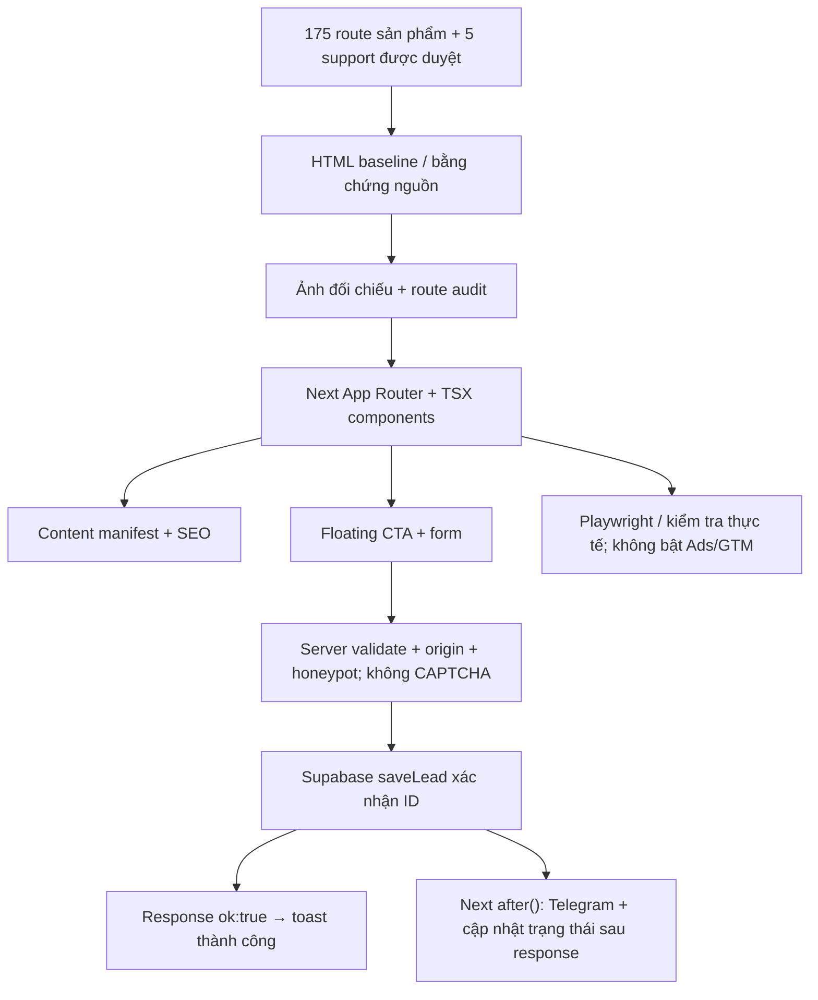

# Kiến trúc mã nguồn



## Source tree

```text
VIETTELUP-CODEX-KIT/
├── data/
│   ├── approved-routes.example.json  # only examples; NOT allowlist
│   ├── pages.example.json            # only data shape
│   ├── approved-routes.json          # bản đối chiếu phạm vi cho kiểm thử
│   └── pages.json                    # archive, không phải runtime/test truth
├── docs/
│   ├── MASTER_PLAN.md
│   ├── ARCHITECTURE.md
│   └── ROUTE_SCOPE.md
├── reference-clone/                 # frozen HTML; intentionally not in repo
├── scripts/verify-route-scope.mjs
├── src/
│   ├── app/
│   │   ├── page.tsx                  # /
│   │   ├── internet/page.tsx         # collection Internet
│   │   ├── internet/[code]/page.tsx  # 18 gói Internet
│   │   ├── goi-cuoc-viettel/[code]/page.tsx          # 101 gói thường
│   │   ├── goi-cuoc-viettel/tra-sau/[code]/page.tsx  # 15 gói trả sau
│   │   ├── tin-tuc/page.tsx          # danh sách tin
│   │   ├── tin-tuc/[slug]/page.tsx   # 35 bài viết
│   │   ├── goi-cuoc-{gic,nine,roaming}/page.tsx
│   │   ├── {gioi-thieu,lien-he,chinh-sach-bao-mat,dieu-khoan}/page.tsx
│   │   ├── goi-cuoc-viettel/page.tsx # support package hub
│   │   ├── api/leads/route.ts        # server-only intake, durable storage required
│   │   ├── layout.tsx
│   │   ├── robots.ts
│   │   └── sitemap.ts
│   ├── components/
│   │   ├── leads/lead-dialog.tsx
│   │   ├── site/floating-contact.tsx
│   │   └── ui/{button,dialog}.tsx
│   ├── components/{home,packages,internet,news,gic,nine,roaming,...}/
│   ├── constants/{home,news,packages}/page-content.ts
│   ├── content/{packages,news,internet}/ # nội dung TSX; Internet có page-content.ts
│   ├── features/collections/        # runtime chung và page-content.ts
│   └── lib/{approved-routes,site-routes,page-content-registry,page-routing,...}.ts
├── tests/{route-scope.test.ts,e2e/smoke.spec.ts}
├── .env.example
├── next.config.ts
├── package.json
└── README.md
```

Mỗi `app/**/page.tsx` gọi trực tiếp component của nhóm tương ứng. Bốn route động nhận đúng một segment (`code` hoặc `slug`), giữ nguyên chữ hoa/thường và phân biệt gói trả sau trùng mã. Không còn catch-all toàn site.

`src/lib/page-content-registry.ts` thực tế nhập `src/constants/{home,news,packages}/page-content.ts`, `src/content/internet/page-content.ts` và `src/features/collections/page-content.ts`; xác minh đủ 175 đường dẫn và product ID khi nạp module server. Không giả định tất cả metadata đã chuyển vào `src/content/`. `src/lib/server/page-repository.ts` tra registry trong bộ nhớ (compatibility `site-data.ts` đã được coordinator xóa); không đọc `data/pages.json` hoặc generated capture mỗi request. JSON asset và tỉnh/phường vẫn là dữ liệu kỹ thuật, không mô tả cây giao diện.

Mọi route approved render, kể cả draft; chỉ `ready` được index/sitemap/canonical/JSON-LD. Support có registry riêng 5 route, nên SEO allowlist là 180 chứ không phải sitemap cố định 180. Draft có `noindex,nofollow`, không canonical/JSON-LD. Form luôn mở, không phụ thuộc readiness của privacy hoặc capture flag. Không có cờ xuất bản/preview cũ.

CAPTCHA đã gỡ; giữ validation, origin, honeypot, chống gửi lặp và server-resolved product identity. Form chung yêu cầu consent thật/phiên bản (mặc định `v1`); modal collection `/internet` không có control consent, không suy diễn chấp thuận, lưu `consent_at`/`privacy_policy_version` là `null` khi không có consent. API chờ `saveLead` trả ID, đăng ký Telegram và cập nhật trạng thái bằng Next `after()`, rồi trả ngay `{ok:true}` sau xác nhận DB để form hiện toast thành công. Telegram chạy sau response; lỗi thông báo không đổi kết quả thành công. DB giữ trạng thái `failed` khi gửi lỗi/thiếu cấu hình hoặc còn `pending` nếu cập nhật trạng thái lỗi; không tự gửi lại/queue. Thiếu storage trả `503 lead_storage_unconfigured` trước đọc body; lỗi lưu trả `503 lead_intake_unavailable`; form giữ dữ liệu. Biến storage hiện có giá trị, nhưng Supabase đã trả `404 PGRST205` do thiếu `public.leads`; cần chạy `db/setup-leads.sql` trong SQL Editor rồi xác minh lại; xem `docs/SITE_ENV.md`.

SEO smoke script hiện ở `scripts/seo/smoke-test.mjs`, không còn trong app source. Biến `SITE_CONTACT_EMAIL` vẫn là cấu hình runtime; không xóa chỉ vì cleanup các env không dùng.

## Công cụ và cleanup dự kiến

Dùng pnpm theo `packageManager`, chỉ giữ `pnpm-lock.yaml`. CI đã được coordinator cấu hình routes/type/lint/test/format:check/build (`pnpm exec eslint . --max-warnings 0` cho lint); chưa khẳng định CI/checks đã đạt trong đợt tài liệu này.

Các app package private folders `_components/_data/_content`, orphan `src/features/{home,internet}/page-content.ts`, source pages collection và UI carousel cũ không còn ở đường dẫn cũ. News generate/verify CJS hiện ở `scripts/news/`, evidence tại `reports/source-news/`. Đây là đối chiếu cây file, không phải kiểm tra hồi quy. Giữ `data/pages.json` có nhãn archive, không làm nguồn sự thật runtime/test. GTM chưa được tích hợp; cấu hình không dùng sẽ xóa, không bật. Đây là kế hoạch cleanup, không phải bằng chứng đã hoàn tất.
