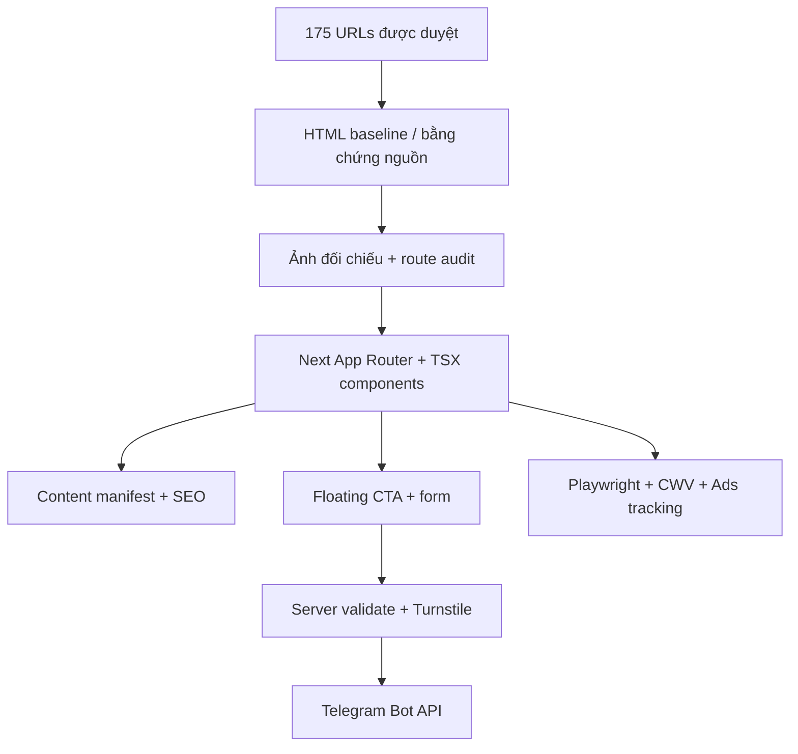

# Kiến trúc mã nguồn



## Source tree

```text
VIETTELUP-CODEX-KIT/
├── data/
│   ├── approved-routes.example.json  # only examples; NOT allowlist
│   ├── pages.example.json            # only data shape
│   ├── approved-routes.json          # bản đối chiếu phạm vi cho kiểm thử
│   └── pages.json                    # nội dung trước migration, đối chiếu hồi quy
├── docs/
│   ├── MASTER_PLAN.md
│   ├── ARCHITECTURE.md
│   └── ROUTE_SCOPE.md
├── reference-clone/                 # frozen HTML; intentionally not in repo
├── scripts/verify-route-scope.mjs
├── src/
│   ├── app/
│   │   ├── page.tsx                  # /
│   │   ├── internet/page.tsx         # collection Internet
│   │   ├── internet/[code]/page.tsx  # 18 gói Internet
│   │   ├── goi-cuoc-viettel/[code]/page.tsx          # 101 gói thường
│   │   ├── goi-cuoc-viettel/tra-sau/[code]/page.tsx  # 15 gói trả sau
│   │   ├── tin-tuc/page.tsx          # danh sách tin
│   │   ├── tin-tuc/[slug]/page.tsx   # 35 bài viết
│   │   ├── goi-cuoc-{gic,nine,roaming}/page.tsx
│   │   ├── api/leads/route.ts        # server-only Telegram gateway
│   │   ├── layout.tsx
│   │   ├── robots.ts
│   │   └── sitemap.ts
│   ├── components/
│   │   ├── leads/lead-dialog.tsx
│   │   ├── site/floating-contact.tsx
│   │   └── ui/{button,dialog}.tsx
│   ├── features/                    # component TSX, dữ liệu có kiểu, page-content.ts từng nhóm
│   └── lib/{approved-routes,page-content-registry,page-routing,site-data,...}.ts
├── tests/{route-scope.test.ts,e2e/smoke.spec.ts}
├── .env.example
├── next.config.ts
├── package.json
└── README.md
```

Mỗi `app/**/page.tsx` gọi trực tiếp component của nhóm tương ứng. Bốn route động nhận đúng một segment (`code` hoặc `slug`), giữ nguyên chữ hoa/thường và phân biệt gói trả sau trùng mã. Không còn catch-all toàn site.

`features/*/page-content.ts` chứa metadata/trạng thái/nội dung có kiểu; `lib/page-content-registry.ts` xác minh đủ 175 đường dẫn và product ID khi nạp module server. `site-data.ts` tra cứu registry trong bộ nhớ, giữ guard draft/ready, sitemap và API lead; không đọc `data/pages.json` hoặc generated capture khi có request. JSON về asset và tỉnh/phường vẫn là dữ liệu kỹ thuật, không dùng để mô tả cây giao diện.
